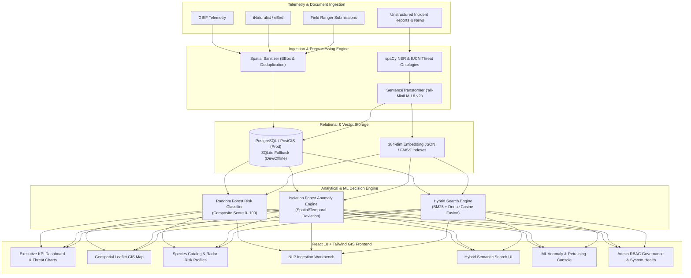

# National Wildlife Conservation Intelligence Platform (NWCIP)
### *AI-Assisted Biodiversity Decision-Support & Spatial Intelligence System*
**Final-Year B.Tech Computer Science & Engineering (CSE) Capstone Project**

---

## 📌 Executive Overview

The **National Wildlife Conservation Intelligence Platform (NWCIP)** is an integrated, production-grade AI decision-support platform designed to synthesize multi-source biodiversity telemetry, unstructured wildlife enforcement incident dispatches, dense vector semantic retrieval, and machine learning risk heuristics into a single operational interface.

Rather than treating conservation analytics as disconnected proof-of-concept demos, NWCIP implements a unified architecture combining:
1. **Multi-Source Ingestion & Spatial Sanitization Engine**: Ingests GBIF, iNaturalist, eBird, and field telemetry, validating Indian territorial boundaries (6°N–38°N, 68°E–98°E), detecting spatial outliers, and canonicalizing taxonomy.
2. **NLP Document Intelligence Pipeline**: Processes field dispatches, anti-poaching logs, and research articles using sentence segmentation, spaCy Named Entity Recognition (NER), IUCN v3.2 threat ontology matching, zero-shot topic classification, LSA summarization, and 384-dimensional dense vector embeddings.
3. **Multi-Modal Hybrid Search**: Fuses sparse lexical BM25 matching and dense vector cosine similarity via an adjustable $\alpha$-balance parameter ($S = (1-\alpha) \cdot S_{\text{lex}} + \alpha \cdot S_{\text{vec}}$).
4. **Machine Learning Risk & Anomaly Engine**: Computes composite species vulnerability scores ($0\text{--}100$) using Random Forest supervised regression on temporal trend, threat density, and observation frequency; detects ecological and spatial deviations using Isolation Forest ($p < -0.5$).
5. **Interactive Geospatial Intelligence GIS**: React Leaflet dark-mode interface rendering dynamic risk-colored cluster markers, click-to-pick coordinate inspection, and live field observation submission.
6. **Role-Based Access Control (RBAC)**: Enforces 5 distinct conservation personas (`ADMIN`, `RESEARCHER`, `FOREST_OFFICER`, `NGO`, `CITIZEN`) across 11 discrete permissions with JWT authentication and bcrypt password hashing.

---

## 🏛️ System Architecture



---

## 🚀 Key Functional Modules

### 1. Geospatial Telemetry & Sighting Ingest
- Coordinates validated against Indian borders ($[6.0, 38.0]^\circ\text{N}$, $[68.0, 98.0]^\circ\text{E}$).
- Interactive map pin-drop to capture telemetry points.
- Instant submission form for field rangers and citizen observers with real-time map refresh.

### 2. NLP Conservation Intelligence
- **NER & Taxonomy Matching**: Resolves binomial nomenclature (e.g. *Panthera tigris tigris* $\rightarrow$ Bengal Tiger) against the internal species registry.
- **IUCN Threat Ontology Matcher**: Maps keyword clusters to IUCN categories (Poaching, Habitat Loss, Conflict, Linear Infrastructure, Mining, etc.).
- **LSA Summarization**: Extracts salient threat narratives and recommendations for rapid officer briefing.
- **384-dim Dense Embeddings**: Generated via `all-MiniLM-L6-v2` for cross-lingual semantic matching.

### 3. Machine Learning Models
- **Extinction Risk Estimator**: Random Forest regression combining observation drop rate, proximity to linear infrastructure, threat occurrence frequency, and baseline IUCN 3.1 criteria into a normalized $0\text{--}100$ vulnerability index.
- **Spatial-Temporal Anomaly Detector**: Unsupervised Isolation Forest flags sudden observation vacuums, uncharacteristic dispersal into human settlements, or poaching spikes ($z\text{-score} < -0.5$).
- **Explainability**: Radar profile charts expose feature contributions (Observation Frequency, Threat Density, Temporal Trend, Composite Risk).

### 4. Role-Based Access Control (RBAC)
| Role | Dashboard | View Map & Catalog | Submit Sightings | Verify Sightings | Ingest NLP Docs | Run/Retrain ML | Admin Panel |
|---|:---:|:---:|:---:|:---:|:---:|:---:|:---:|
| **ADMIN** | ✅ | ✅ | ✅ | ✅ | ✅ | ✅ | ✅ |
| **RESEARCHER** | ✅ | ✅ | ✅ | ✅ | ✅ | ✅ | ❌ |
| **FOREST_OFFICER** | ✅ | ✅ | ✅ | ✅ | ✅ | ❌ | ❌ |
| **NGO** | ✅ | ✅ | ✅ | ❌ | ✅ | ❌ | ❌ |
| **CITIZEN** | ✅ | ✅ | ✅ | ❌ | ❌ | ❌ | ❌ |

---

## 🔑 Demo Personas & Seed Credentials

Use the one-click **Persona Switcher** in the top-right navbar, or authenticate via `/api/v1/auth/login`:

| Persona | Email | Password | Intended Workflow |
|---|---|---|---|
| **Administrator** | `admin@wildlife.gov.in` | `Admin@123` | Full governance, role assignment, model retraining, system health |
| **WII Researcher** | `researcher@wildlife.gov.in` | `Researcher@123` | ML risk evaluation, model performance metrics, dataset analysis |
| **Field Forest Officer** | `officer@forest.gov.in` | `Officer@123` | Sighting verification, enforcement logs, patrol incident monitoring |
| **WWF Coordinator** | `ngo@wwfindia.org` | `Ngo@123` | Document ingestion, habitat threat tracking, community reports |
| **Citizen Contributor** | `citizen@gmail.com` | `Citizen@123` | Sighting submissions, public biodiversity atlas exploration |

---

## 🛠️ Technology Stack

| Layer | Technologies |
|---|---|
| **Frontend** | React 18, Vite 6, Tailwind CSS 3, Leaflet, React-Leaflet, Recharts, Lucide React |
| **Backend API** | FastAPI, Python 3.12+, Uvicorn, Pydantic v2 |
| **NLP & Search** | spaCy (`en_core_web_sm`), Sentence-Transformers (`all-MiniLM-L6-v2`), Sumy LSA, BM25 Lexical |
| **Machine Learning** | Scikit-learn (RandomForestRegressor, IsolationForest), NumPy |
| **Database & ORM** | PostgreSQL + PostGIS (Production) / SQLite fallback (Development), SQLAlchemy 2.0 |
| **Authentication** | JWT (JSON Web Tokens), Passlib, Bcrypt |
| **Testing** | Pytest, HTTPX, AnyIO (30/30 Unit & Integration Tests Passing) |

---

## ⚡ Quickstart Guide

### 1. Prerequisites
- Python 3.11+
- Node.js 18+ & npm

### 2. Backend Setup
```powershell
# Navigate to project root
cd "C:\Users\Anurag Mukherjee\Desktop\Wildlife Conservation"

# Install backend dependencies
pip install -r backend/requirements.txt

# Seed rich demonstration dataset (20 species, 165 observations, 17 docs, 17 anomalies)
python scripts/seed_demo_data.py

# Launch FastAPI backend (accessible at http://localhost:8000)
python -m uvicorn backend.app.main:app --host 0.0.0.0 --port 8000 --reload
```

### 3. Frontend Setup
```powershell
# Navigate to frontend folder
cd "C:\Users\Anurag Mukherjee\Desktop\Wildlife Conservation\frontend"

# Install npm dependencies
npm install

# Start Vite dev server (accessible at http://localhost:3000)
npm run dev
```

### 4. Running Automated Tests
```powershell
# Run the complete test suite (30 passed in ~25s)
python -m pytest backend/tests/ -v
```

---

## 📊 Live Verification Checklist

- [x] **Backend Health Check**: `GET http://localhost:8000/health` $\rightarrow$ `{"status": "HEALTHY"}`
- [x] **API Documentation**: Interactive Swagger UI at `http://localhost:8000/docs`
- [x] **Authentication & RBAC**: JWT login and role claims validated across all endpoints.
- [x] **Executive Dashboard**: KPI summary, aggregated threat pressure bar chart, real-time alerts feed.
- [x] **Geospatial GIS Map**: Dark-themed Leaflet map with 165+ observation circles, threat scale legend, and coordinate click-to-pick.
- [x] **Species Catalog**: 20 taxa, IUCN 3.1 badges, sortable vulnerability bars, inline Radar charts.
- [x] **NLP Pipeline**: Real-time document ingestion with NER, topic tagging, threat extraction, and LSA summary.
- [x] **Hybrid Search**: Interactive $\alpha$-balance slider fusing BM25 lexical keywords and 384-dim semantic similarity.
- [x] **ML Anomaly Console**: Isolation Forest scatter distribution, precision/recall metrics, and retrain triggers.
- [x] **Admin Governance**: System health indicators, user management table, and full RBAC matrix.

---

## ⚖️ Academic Integrity & Scientific Disclaimer

> **[!NOTE]**
> This software is constructed as an **AI-Assisted Conservation Intelligence Decision-Support System** for academic demonstration and research purposes. Machine learning risk indices and anomaly flags are designed to prioritize human expert verification and patrol dispatch; they do not replace formal scientific peer review, field ecology census protocols, or official government wildlife authority directives.
