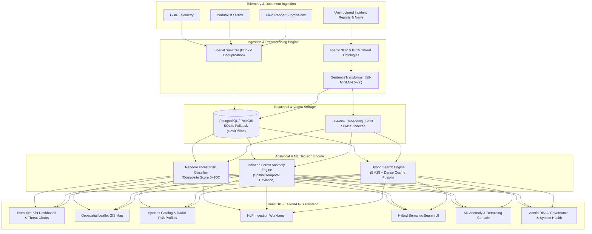

# Architecture Diagrams

The platform’s high‑level architecture is already documented in the README as a Mermaid flowchart. Below is the same diagram reproduced for the report.

The diagram illustrates the flow from data sources through ingestion, storage, intelligence, and finally to the user‑facing web application.

