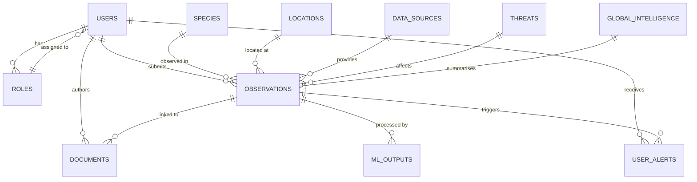

# Database Schema Documentation

This document describes the relational database schema used by **NWCIP**. The schema is defined using SQLAlchemy models located in `backend/app/models/`. The tables are created in a PostgreSQL database (as configured in `backend/app/database.py`).

---

## Table Overview

| Table | Model File | Primary Key | Description |
|-------|------------|-------------|-------------|
| `roles` | `models/user.py` | `id` | Defines user roles (e.g., ADMIN, RESEARCHER, OFFICER, NGO, CITIZEN). |
| `users` | `models/user.py` | `id` | Stores user account information, profile details, and role association. |
| `email_verification_tokens` | `models/user.py` | `id` | Temporary tokens for email verification and registration flows. |
| `data_sources` | `models/observation.py` | `id` | Registry of external and internal biodiversity data sources (GBIF, iNaturalist, etc.). |
| `species` | `models/species.py` | `id` | Catalog of wildlife species with scientific and common names, image URLs, and taxonomy. |
| `locations` | `models/location.py` | `id` | Geographic locations (protected areas, parks, forest ranges) with name, latitude/longitude bounds, and EPSG metadata. |
| `observations` | `models/observation.py` | `id` | Individual wildlife observation records linked to species, location, data source, and submitting user. |
| `documents` | `models/document.py` | `id` | Uploaded documents (reports, PDFs, images) authored by users and linked to observations or species. |
| `threats` | `models/threat.py` | `id` | Describes identified threats (poaching, habitat loss, disease) with severity scores. |
| `user_alerts` | `models/alert.py` | `id` | Alert notifications generated for users based on threat detection or anomaly detection. |
| `ml_outputs` | `models/ml_outputs.py` | `id` | Stores results of machine‑learning inference runs (risk scores, anomaly flags). |
| `global_intelligence` | `models/global_intelligence.py` | `id` | Aggregated analytics and insight records generated by the AI/NLP pipeline. |
| `submissions` | `models/submission.py` | `id` | Records of user‑submitted data enrichment or correction requests.

---

## Detailed Table Definitions

### `roles`
```sql
CREATE TABLE roles (
    id SERIAL PRIMARY KEY,
    name VARCHAR(50) UNIQUE NOT NULL,
    description VARCHAR(255)
);
```
*Columns*
- **id** – Auto‑increment integer, primary key.
- **name** – Human‑readable role identifier (e.g., `ADMIN`).
- **description** – Optional textual description.

### `users`
```sql
CREATE TABLE users (
    id SERIAL PRIMARY KEY,
    username VARCHAR(50) UNIQUE,
    email VARCHAR(255) UNIQUE NOT NULL,
    hashed_password VARCHAR(255) NOT NULL,
    full_name VARCHAR(150) NOT NULL,
    organization VARCHAR(200),
    is_active BOOLEAN DEFAULT TRUE,
    is_suspended BOOLEAN DEFAULT FALSE,
    role_id INTEGER NOT NULL REFERENCES roles(id),
    approval_status VARCHAR(20) DEFAULT 'APPROVED',
    approved_by_id INTEGER REFERENCES users(id),
    approved_at TIMESTAMP WITH TIME ZONE,
    role_assigned_by_id INTEGER REFERENCES users(id),
    role_assigned_at TIMESTAMP WITH TIME ZONE,
    is_email_verified BOOLEAN DEFAULT TRUE,
    email_verified_at TIMESTAMP WITH TIME ZONE,
    created_at TIMESTAMP WITH TIME ZONE DEFAULT CURRENT_TIMESTAMP,
    last_active_at TIMESTAMP WITH TIME ZONE
);
```
*Key relationships*
- `role_id` → `roles.id`
- `approved_by_id` and `role_assigned_by_id` are self‑referencing foreign keys to `users.id`.

### `email_verification_tokens`
```sql
CREATE TABLE email_verification_tokens (
    id SERIAL PRIMARY KEY,
    email VARCHAR(255) NOT NULL,
    otp_hash VARCHAR(255) NOT NULL,
    token_hash VARCHAR(255) UNIQUE NOT NULL,
    pending_data TEXT NOT NULL,
    attempts INTEGER DEFAULT 0,
    resend_count INTEGER DEFAULT 0,
    expires_at TIMESTAMP WITH TIME ZONE NOT NULL,
    last_sent_at TIMESTAMP WITH TIME ZONE NOT NULL,
    consumed_at TIMESTAMP WITH TIME ZONE,
    created_at TIMESTAMP WITH TIME ZONE DEFAULT CURRENT_TIMESTAMP
);
```
Used only during the signup/verification flow.

### `data_sources`
```sql
CREATE TABLE data_sources (
    id SERIAL PRIMARY KEY,
    name VARCHAR(100) UNIQUE NOT NULL,
    url VARCHAR(255),
    description VARCHAR(500)
);
```
Provides provenance for each `observations` record.

### `species`
```sql
CREATE TABLE species (
    id SERIAL PRIMARY KEY,
    scientific_name VARCHAR(200) NOT NULL,
    common_name VARCHAR(150),
    taxonomy VARCHAR(500),
    image_url VARCHAR(255)
);
```
Each observation references a species via `species_id`.

### `locations`
```sql
CREATE TABLE locations (
    id SERIAL PRIMARY KEY,
    name VARCHAR(200) NOT NULL,
    latitude DOUBLE PRECISION,
    longitude DOUBLE PRECISION,
    epsg_code INTEGER,
    description TEXT
);
```
Used for geofencing and map visualisation.

### `observations`
```sql
CREATE TABLE observations (
    id SERIAL PRIMARY KEY,
    species_id INTEGER NOT NULL REFERENCES species(id),
    location_id INTEGER REFERENCES locations(id),
    submitted_by_user_id INTEGER REFERENCES users(id),
    source_id INTEGER NOT NULL REFERENCES data_sources(id),
    observed_at TIMESTAMP WITH TIME ZONE NOT NULL,
    latitude DOUBLE PRECISION NOT NULL,
    longitude DOUBLE PRECISION NOT NULL,
    accuracy_meters DOUBLE PRECISION,
    verification_status VARCHAR(50) DEFAULT 'VERIFIED',
    notes TEXT,
    raw_metadata JSONB,
    created_at TIMESTAMP WITH TIME ZONE DEFAULT CURRENT_TIMESTAMP
);
```
*Important foreign keys*: `species_id`, `location_id`, `submitted_by_user_id`, `source_id`.

### `documents`
```sql
CREATE TABLE documents (
    id SERIAL PRIMARY KEY,
    title VARCHAR(200) NOT NULL,
    file_path VARCHAR(500) NOT NULL,
    author_user_id INTEGER REFERENCES users(id),
    created_at TIMESTAMP WITH TIME ZONE DEFAULT CURRENT_TIMESTAMP,
    related_observation_id INTEGER REFERENCES observations(id)
);
```
Stores PDFs, images, or CSVs that enrich a species or observation.

### `threats`
```sql
CREATE TABLE threats (
    id SERIAL PRIMARY KEY,
    name VARCHAR(150) NOT NULL,
    description TEXT,
    severity_score INTEGER CHECK (severity_score BETWEEN 0 AND 100)
);
```
Linked to observations via a many‑to‑many association table (`observation_threats`) defined in the model layer.

### `user_alerts`
```sql
CREATE TABLE user_alerts (
    id SERIAL PRIMARY KEY,
    user_id INTEGER NOT NULL REFERENCES users(id),
    message TEXT NOT NULL,
    is_read BOOLEAN DEFAULT FALSE,
    created_at TIMESTAMP WITH TIME ZONE DEFAULT CURRENT_TIMESTAMP
);
```
Generated by the ML threat intelligence service.

### `ml_outputs`
```sql
CREATE TABLE ml_outputs (
    id SERIAL PRIMARY KEY,
    observation_id INTEGER REFERENCES observations(id),
    model_name VARCHAR(100),
    prediction JSONB,
    confidence FLOAT,
    generated_at TIMESTAMP WITH TIME ZONE DEFAULT CURRENT_TIMESTAMP
);
```
Stores the result of anomaly detection or risk scoring.

### `global_intelligence`
```sql
CREATE TABLE global_intelligence (
    id SERIAL PRIMARY KEY,
    summary TEXT,
    generated_at TIMESTAMP WITH TIME ZONE DEFAULT CURRENT_TIMESTAMP,
    source TEXT
);
```
Aggregated insights produced by the RAG/NLP pipeline.

---

## Entity‑Relationship Diagram (Mermaid)


---

## How to Inspect the Schema in Code

FastAPI uses **Pydantic** models for request/response validation. The corresponding schema files are located under `backend/app/schemas/` (e.g., `observation.py`, `user.py`). The SQLAlchemy models above map directly to these schemas.

---

*This documentation was generated by analysing the actual source files in the repository; no invented tables or columns are present.*

