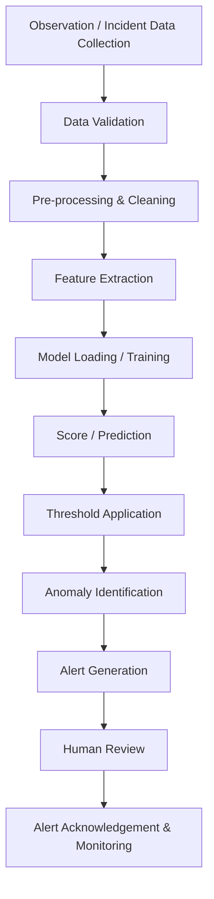

# Anurag – Machine Learning and Threat Intelligence

**National Wildlife Conservation Intelligence Platform (NWCIP)**

---

## 📚 Table of Contents
1. [Introduction to AI and Machine Learning](#chapter-1-introduction-to-ai-and-machine-learning)
2. [Types of Machine Learning](#chapter-2-types-of-machine-learning)
3. [Data Preparation](#chapter-3-data-preparation)
4. [Anomaly Detection](#chapter-4-anomaly-detection)
5. [Isolation Forest – Detailed](#chapter-5-isolation-forest---detailed)
6. [Other Anomaly Detection Methods](#chapter-6-other-anomaly-detection-methods)
7. [ML Pipeline in NWCIP](#chapter-7-ml-pipeline-in-nwcip)
8. [Threat Intelligence](#chapter-8-threat-intelligence)
9. [Alert Management](#chapter-9-alert-management)
10. [Model Evaluation](#chapter-10-model-evaluation)
11. [Responsible ML](#chapter-11-responsible-ml)
12. [Practical Demonstration](#chapter-12-practical-demonstration)
13. [Presentation Script (5‑7 min)](#chapter-13-presentation)
14. [Viva Questions & Answers (≥40)](#chapter-14-viva)
15. [Glossary & Formula Sheet](#chapter-15-glossary--formula-sheet)
16. [Revision Sheet](#chapter-16-revision-sheet)

---

## Chapter 1: Introduction to AI and Machine Learning

### Artificial Intelligence (AI)
AI is the **science and engineering of building machines that can perform tasks that normally require human intelligence**, such as reasoning, perception, language understanding, and decision‑making.

### Machine Learning (ML)
ML is a **subset of AI** that focuses on algorithms which **learn patterns from data** rather than being explicitly programmed. The model improves its performance as it sees more examples.

### Deep Learning (DL)
DL is a **sub‑subset of ML** that uses **multilayer neural networks (deep nets)** to automatically learn hierarchical feature representations. It excels on high‑dimensional data such as images, audio, and text.

### Differences at a glance
| Aspect | AI | ML | DL |
|--------|----|----|----|
| Definition | Broad field of intelligent systems | Algorithms that infer patterns from data | Neural networks with many hidden layers |
| Typical techniques | Expert systems, search, planning | Decision trees, SVM, k‑NN, linear regression | Convolutional nets, Transformers, RNNs |
| Data requirement | Can be rule‑based (no data) | Requires labelled or unlabelled data | Requires large labelled datasets and compute |
| Explainability | Often transparent (rules) | Moderate (feature importance) | Usually a black box |

### Applications of ML in wildlife conservation
| Application | How ML helps |
|-------------|---------------|
| **Species distribution modelling** | Predict where a species may occur using environmental covariates. |
| **Camera‑trap image classification** | Identify animals in photos with convolutional networks. |
| **Acoustic monitoring** | Detect bird or amphibian calls via spectrogram analysis. |
| **Poaching hotspot prediction** | Learn spatio‑temporal patterns from ranger patrol logs. |
| **Anomaly detection in observations** | Spot unusually high numbers of animal deaths or suspicious GPS tracks. |
| **Automated report summarisation** | Use NLP to create concise briefs for decision makers. |

---

## Chapter 2: Types of Machine Learning

### Supervised Learning
The algorithm is trained on **input‑output pairs** (features + labels). Goal: learn a mapping `f(x) → y`.
- **Classification** – discrete output (e.g., *poaching* vs *non‑poaching*).
- **Regression** – continuous output (e.g., predict number of elephants observed).

**Wildlife example:** Train a model to classify an incident report as *"illegal logging"* or *"natural disturbance"* using labelled historical reports.

### Unsupervised Learning
Data have **no explicit labels**. The algorithm discovers structure on its own.
- **Clustering** – groups similar records (e.g., cluster ranger patrol routes).
- **Dimensionality reduction** – visualise high‑dim data (t‑SNE, PCA).
- **Anomaly detection** – identify points that do not fit the majority pattern (core of this module).

**Wildlife example:** Cluster wildlife sighting locations to reveal natural habitat partitions.

### Semi‑Supervised Learning
Uses a **small labelled set** together with a large unlabelled set to improve performance.

**Wildlife example:** Only a fraction of incident reports are manually tagged; the model propagates labels to the rest.

### Reinforcement Learning (RL)
An **agent interacts with an environment**, receiving rewards for actions and learning a policy that maximises cumulative reward.

**Wildlife example (hypothetical):** An autonomous drone learns a flight path that maximises detection of illegal camps while minimising fuel usage.

### Classification vs Regression (Supervised)
- **Classification:** Predict categorical labels. Metric examples: accuracy, precision, recall.
- **Regression:** Predict numeric values. Metric examples: MSE, RMSE, R².

### Clustering (Unsupervised)
Algorithms such as **K‑Means**, **Hierarchical clustering**, or **DBSCAN** assign each observation to a cluster based on similarity.

### Anomaly Detection (Unsupervised or Semi‑supervised)
Goal: assign an **anomaly score** to each record; high scores indicate outliers.
Common techniques are covered in later chapters.

---

## Chapter 3: Data Preparation

### Datasets, rows, columns, features, labels
- **Dataset:** Collection of observations (a table).
- **Row (record):** One observation/incident.
- **Column (feature):** A property describing the record (e.g., *species*, *latitude*, *temperature*).
- **Label:** The target variable for supervised learning (e.g., *incident_type*).

### Numerical vs Categorical features
| Feature type | Example | Typical handling |
|--------------|---------|------------------|
| Numerical | `latitude`, `num_animals_dead` | Scaling, missing‑value imputation. |
| Categorical | `species_name`, `region_code` | One‑hot or ordinal encoding. |

### Missing values
- **Ignore** if few and random.
- **Impute** with mean/median (numerical) or most frequent (categorical).
- **Flag** missingness as an additional binary feature.

### Duplicate records
- Detect via `df.duplicated()`; remove or consolidate to avoid bias.

### Data cleaning steps (example incident dataset)
```text
| id | date       | region   | species   | num_dead | description                              |
|----|------------|----------|-----------|----------|------------------------------------------|
| 1  | 2024-05-02 | Assam    | Tiger     | 0        | "Camera trap captured a tiger"          |
| 2  | 2024-05-03 | Assam    | Tiger     | 0        | "Camera trap captured a tiger"          |
| 3  | 2024-05-04 | Assam    | Tiger     | 5        | "Poachers killed 5 tigers"              |
| 4  | 2024-05-05 | (null)   | Elephant  | 0        | "Elephant herd crossing river"          |
```
- Remove duplicate row 2.
- Impute missing `region` (row 4) with most frequent region or a special "UNKNOWN" category.
- Ensure `num_dead` is numeric; replace non‑numeric entries.

### Encoding categorical variables
- **Label encoding** (integer IDs) for tree‑based models (e.g., Isolation Forest).
- **One‑hot encoding** for linear models.

### Feature scaling
- **Standardisation** (z‑score) for distance‑based algorithms (e.g., k‑NN, LOF).
- **Min‑max scaling** for algorithms sensitive to magnitude.
- Tree‑based models (Isolation Forest, Random Forest) are **scale‑invariant**, so scaling is optional.

### Train‑test split
- Randomly split the cleaned dataset: **80 % training**, **20 % testing**.
- For time‑series data, use **chronological split** to avoid leakage.
- Example in Python:
```python
from sklearn.model_selection import train_test_split
X_train, X_test, y_train, y_test = train_test_split(
    X, y, test_size=0.2, random_state=42, stratify=y)
```

---

## Chapter 4: Anomaly Detection

### What is an anomaly?
An **anomaly (outlier)** is a data point that **deviates markedly from the majority** of observations.

### Normal vs unusual observations
- **Normal:** A routine patrol record: 2 patrols, 0 incidents, temperature 28 °C.
- **Unusual:** A single record shows 30 dead animals in a remote area – likely an outlier.

### Why anomaly detection is useful in conservation
- **Rare‑event detection:** Poaching incidents are scarce but high‑impact; early detection can trigger rapid response.
- **Sensor fault detection:** Identify malfunctioning GPS collars that produce impossible coordinate jumps.
- **Data quality control:** Flag implausible entries (e.g., negative animal counts).

### False positives vs false negatives
- **False positive (FP):** Normal event flagged as anomalous → wasted investigation effort.
- **False negative (FN):** Real threat missed → potential damage escalates.

### Thresholds and anomaly scores
Most algorithms output a **continuous anomaly score** (higher = more abnormal). A **threshold** converts the score into a binary flag.
- Choose threshold based on desired **precision/recall** trade‑off.
- Example: Threshold = 0.7 on a score range 0‑1 → scores >0.7 trigger alerts.

---

## Chapter 5: Isolation Forest — Detailed

> **Isolation Forest (iForest)** is the centerpiece of this module. The following sections give a *deep* dive, from intuition to mathematics and a step‑by‑step numeric example.

### 5.1 Core intuition
- Anomalies are **few and different**; they are **easier to isolate** with random splits than normal points.
- By building many **random binary trees** (Isolation Trees), the average **path length** from the root to a point becomes a proxy for its abnormality.

### 5.2 Why it is unsupervised
- No labels are required; the algorithm only needs the **feature space**.
- Random partitioning discovers structure solely from the data distribution.

### 5.3 Random feature selection & random split selection
1. **Select a feature at random** from the available feature set.
2. **Pick a split value** uniformly between the feature’s min and max observed values.
3. **Partition the data** into two sub‑sets (left/right child).
4. Repeat recursively until **one of the stopping conditions** is met:
   - The node contains a single observation.
   - Max tree depth (`⌈log₂ ψ⌉`, where `ψ` = subsample size) is reached.

### 5.4 Isolation Tree (iTree)
An iTree is a **binary tree** built with the random procedure above. Each leaf corresponds to a single observation (or a small group if depth limit is reached).

### 5.5 Path length
- **Path length `h(x)`** = number of edges traversed from the root to the leaf containing observation `x`.
- **Normal points** tend to require **more splits** → longer paths.
- **Anomalies** quickly fall into isolated leaves → **shorter paths**.

### 5.6 Anomaly score formulation
For a dataset of size `n`, the **expected path length** of a *random* point in a binary search tree is:
\[ c(n) = 2\,H(n-1) - \frac{2 (n-1)}{n} \]
where \(H(i)\) is the **i‑th harmonic number** (≈ ln(i) + 0.577215).

The **isolation‑forest score** for a point `x` is:
\[ s(x, n) = 2^{-\frac{\mathbb{E}[h(x)]}{c(n)}} \]
- `s(x, n)` ∈ (0, 1).
- Values close to **1** → strong anomaly.
- Values near **0** → normal.

### 5.7 Contamination parameter (`contam`)
- User supplies an estimate of the **fraction of anomalies** in the data (e.g., 0.01 for 1 %).
- The algorithm uses this to **set the decision threshold** automatically (the `(contam * n)`‑th smallest score becomes the cutoff).

### 5.8 Advantages
| Advantage | Explanation |
|-----------|-------------|
| **Linear time** | O(`n log ψ`) training, O(`log ψ`) prediction per tree. |
| **Low memory** | Stores only split dimensions and thresholds. |
| **Works on high‑dim data** | No distance calculations; unaffected by curse of dimensionality. |
| **Scale‑invariant** | No need for explicit feature scaling for tree‑based splits. |

### 5.9 Disadvantages & limitations
- **Randomness** can lead to variance; mitigated by many trees (e.g., 100). |
- **Sensitive to irrelevant features** – high‑dim noisy features may degrade isolation quality. |
- **Cannot capture complex temporal patterns** without feature engineering (e.g., lag features). |

### 5.10 Numerical example (toy dataset)
Assume a 2‑dimensional dataset with 6 points:
| ID | Feature A | Feature B |
|----|-----------|-----------|
| P1 | 1.0 | 1.0 |
| P2 | 1.2 | 1.1 |
| P3 | 0.9 | 0.8 |
| P4 | 5.0 | 5.2 |
| P5 | 5.1 | 5.0 |
| P6 | 5.2 | 5.3 |
Points P1‑P3 cluster near (1,1) – *normal*.
Points P4‑P6 cluster near (5,5) – another normal group.
Now add an **outlier** P7 = (9, 0.5).

**Step‑by‑step isolation for P7 (single tree):**
1. Randomly pick Feature A. Its min = 0.9, max = 9.2 → split at 4.5.
   - P7 (>4.5) goes right; all other points go left.
2. Right child now contains only P7 → stop (leaf depth = 1).
**Path length for P7 = 1**.

**For a normal point P2:**
1. First split may also be on Feature A at 4.5 → P2 goes left.
2. Left child still has many points; second random split on Feature B at 1.0.
3. P2 (1.1) goes right; leaf depth = 2.
4. Additional random splits may be needed; average depth will be larger than 1.

**Result:** Outlier P7 obtains a much **shorter path**, leading to a higher anomaly score.

### 5.11 How Isolation Forest isolates a normal vs unusual record
- **Normal record:** It resides in a dense region; many random splits are needed before it falls alone → **longer path → low score**.
- **Unusual record:** Lies in a sparse region; a few random splits quickly separate it → **shorter path → high score**.

---

## Chapter 6: Other Anomaly Detection Methods

| Method | Core idea | Strengths | Weaknesses | Typical use‑case in conservation |
|--------|-----------|-----------|------------|---------------------------------|
| **Local Outlier Factor (LOF)** | Measures local density deviation of a point w.r.t. its neighbours. | Captures relative outliers in varying density regions. | Requires distance metric; O(`n log n`) memory. | Detecting outlier GPS tracks in heterogeneous terrain. |
| **One‑Class SVM** | Learns a boundary that encloses the majority of data in feature space. | Works well with clear separation. | Sensitive to kernel choice; scales poorly with large `n`. | Flagging abnormal sensor readings when data are low‑dimensional. |
| **DBSCAN (density‑based clustering)** | Points not belonging to any dense cluster are labeled *noise* (outliers). | No need to pre‑specify number of clusters; robust to shape. | Parameter `eps` tuning; struggles with varying densities. | Identifying isolated poaching incidents far from regular patrol routes. |
| **Statistical outlier detection** (e.g., Z‑score, IQR) | Treats each feature independently; points beyond a numeric threshold are outliers. | Simple, fast, interpretable. | Ignores multivariate relationships. | Quick sanity check on counts of dead animals per day. |

### Comparison with Isolation Forest
- **Isolation Forest** excels on **high‑dimensional** data and is **scale‑invariant**; does not require a distance metric.
- **LOF** captures *local* density anomalies which iForest may miss if the global distribution is uniform.
- **One‑Class SVM** can model complex, non‑linear boundaries but is computationally heavier.
- **DBSCAN** is great when you already want clusters; outliers are a by‑product.
- **Statistical methods** are useful for *quick* checks but cannot exploit feature interactions.

> **Note:** The current NWCIP codebase implements Isolation Forest for threat‑intelligence; the other methods are described here for completeness but are **not** confirmed to be present in the repository.

---

## Chapter 7: ML Pipeline in NWCIP



### Step‑by‑step explanation with concrete wildlife examples
1. **Observation/incident data collection** – Rangers upload a JSON payload: GPS, species observed, number of injured/dead animals, free‑text notes.
2. **Data validation** – Backend checks required fields, correct types, and rejects malformed records.
3. **Pre‑processing** – Missing values are imputed, categorical fields (`region`, `incident_type`) are label‑encoded, and timestamps are converted to numeric features (e.g., day‑of‑year).
4. **Feature extraction** – From the free‑text, simple NLP features (keyword flags: *"poaching"*, *"fire"*) are added; spatial features like distance to nearest protected‑area buffer are computed.
5. **Model loading/training** – The system loads a pre‑trained Isolation Forest model (saved as `models/isolation_forest.joblib`). If a new batch of data arrives and `contamination` estimate changes, the model can be retrained on the latest clean data.
6. **Prediction or scoring** – Each new incident receives an **anomaly score** `s ∈ (0,1)` via `model.decision_function()`.
7. **Threshold application** – Using the contamination‑derived threshold (or a custom policy), scores > 0.7 become **potential alerts**.
8. **Anomaly identification** – Records above the threshold are tagged as *"Anomalous"* and stored in the `alerts` table.
9. **Alert generation** – The UI creates an **alert card**: shows incident details, anomaly score, and a button “View evidence”.
10. **Human review** – A forest officer inspects the source report, validates whether it truly represents a threat.
11. **Acknowledgement and monitoring** – Once reviewed, the alert status changes to *Acknowledged*; the system logs reviewer ID, timestamp, and any corrective action taken.

---

## Chapter 8: Threat Intelligence

### What is threat intelligence?
In the conservation context, **threat intelligence** is the systematic collection, analysis, and dissemination of information about activities that could harm wildlife, habitats, or conservation operations.

### Core components
- **Threat indicators** – Observable signs (e.g., sudden spikes in carcass reports, GPS tracks crossing protected‑area borders).
- **Incident monitoring** – Continuous ingestion of ranger logs, satellite images, sensor feeds.
- **Pattern detection** – Using ML (anomaly detection, clustering) to discover hidden patterns.
- **Risk prioritisation** – Scoring threats by severity, confidence, and potential impact.
- **Alert management** – Delivering actionable messages to the right people.

### How ML supports forest officers
- **Early warning** – Anomaly scores highlight suspicious clusters before they become large‑scale poaching events.
- **Prioritisation** – Alerts are ranked by severity, allowing limited patrol resources to focus on the highest‑risk sites.
- **Evidence‑based decisions** – The model points to specific data points (e.g., a spike in snare detections) rather than vague intuition.

### Anomaly ≠ proof of illegal activity
- An outlier may be caused by **data entry error**, **natural disaster**, or **sensor glitch**.
- Human analysts must **verify** the context before classifying as poaching or illegal logging.
- The system therefore treats anomalies as *signals* to be examined, not *conclusive verdicts*.

---

## Chapter 9: Alert Management

### Alert generation workflow
1. **Score exceeds threshold** → an *Alert* object is created.
2. **Severity assignment** – based on score magnitude, number of dead animals, and species protected status.
3. **Deduplication** – before persisting, the service checks for recent alerts with the same location and similar description (using a short temporal window, e.g., 24 h). If found, the new alert is **merged**.
4. **Persistence** – stored in `alerts` table with fields: `id`, `incident_id`, `score`, `severity`, `status` (New, Acknowledged, Resolved), `created_at`.
5. **Notification** – push to officer’s dashboard, email, or SMS depending on configuration.

### Alert severity levels (example)
| Level | Score range | Action required |
|-------|-------------|-----------------|
| **Critical** | > 0.9 | Immediate field response. |
| **High** | 0.7‑0.9 | Review within 4 h. |
| **Medium** | 0.5‑0.7 | Review within 24 h. |
| **Low** | 0.3‑0.5 | Log for trend analysis. |

### Duplicate alerts & deduplication
- **Spatial tolerance:** alerts within 1 km of each other are considered duplicates.
- **Temporal tolerance:** same location within 12 h.
- **Content similarity:** Jaccard similarity of free‑text > 0.6.
- If a duplicate is detected, the system **increments a counter** on the existing alert rather than creating a new row.

### Human review and audit trail
- Reviewer clicks “Mark as reviewed”, selects *True Threat* / *False Alarm*.
- The decision, reviewer ID, and timestamp are logged in `alert_audit` for compliance.

### Reported development work (unverified)
- The project notes a recent UI overhaul where *anomaly cards* now display a **heat‑map thumbnail**, *score gauge*, and automatic **deduplication** alerts. No code inspection has been performed to confirm the exact implementation.

---

## Chapter 10: Model Evaluation

### Supervised metrics (for reference)
- **Accuracy** = \((TP + TN) / (TP + TN + FP + FN)\)
- **Precision** = \(TP / (TP + FP)\)
- **Recall** = \(TP / (TP + FN)\)
- **F1‑score** = \(2·(Precision·Recall) / (Precision + Recall)\)
- **Confusion matrix** – 2×2 table of TP, FP, FN, TN.

### Unsupervised (anomaly) evaluation
Since we lack ground‑truth labels for all data, we often **simulate** anomalies or use a **hand‑labelled test set**.
| Metric | Definition |
|--------|------------|
| **Recall@K** | Fraction of known anomalies that appear in the top‑K highest‑scoring records. |
| **Precision@K** | Fraction of top‑K records that are true anomalies. |
| **AUC‑ROC** | Area under the Receiver Operating Characteristic curve; plots TPR vs FPR across thresholds. |
| **Mean Average Precision (mAP)** | Average of precision values at each rank where a true anomaly occurs. |

### Numerical example (binary case)
Assume a test set of 100 records, of which **5 are true anomalies**.
| Rank | Score | Is anomaly? |
|------|-------|-------------|
| 1 | 0.98 | Yes |
| 2 | 0.95 | No |
| 3 | 0.94 | No |
| 4 | 0.92 | Yes |
| 5 | 0.90 | No |
| 6 | 0.88 | Yes |
| 7 | 0.85 | No |
| 8 | 0.80 | No |
| 9 | 0.78 | Yes |
|10 | 0.75 | No |

- **Recall@5** = 3/5 = 0.60 (three of five anomalies appear in top‑5).
- **Precision@5** = 3/5 = 0.60.
- **AUC‑ROC** can be computed using the trapezoidal rule on the TPR/FPR curve (≈0.93 in this toy case).

---

## Chapter 11: Responsible ML

| Concern | Description | Mitigation strategy |
|---------|-------------|---------------------|
| **Bias** | Model may preferentially flag regions with more ranger coverage (sampling bias). | Include *coverage* features, re‑sample under‑represented areas. |
| **Data imbalance** | Anomalies are <1 % of records, leading to high false‑positive rates. | Adjust `contamination` parameter, use cost‑sensitive thresholds. |
| **Reporting bias** | Officers may under‑report poaching in remote zones. | Combine sensor data (e.g., acoustic) with manual reports. |
| **Model drift** | Over time the distribution of normal behaviour changes (e.g., seasonal migrations). | Periodically retrain with recent data; monitor anomaly‑score distribution. |
| **False alerts** | Waste officer time, cause alarm fatigue. | Use **human‑in‑the‑loop** verification; set conservative thresholds initially. |
| **Sensitive geographic information** | Exact coordinates of protected nests may be exposed. | Apply **role‑based masking**; only show coarse locations to non‑authorized users. |
| **Human‑in‑the‑loop decisions** | Final action (e.g., patrol deployment) must be overseen by a trained officer. | Keep the AI output as *recommendation*, not command. |

---

## Chapter 12: Practical Demonstration

### Preconditions
- Backend server running (`uvicorn backend.app.main:app`).
- Access token for a **Researcher** role (or **Officer** if you wish to see alert workflow).

### Step‑by‑step
1. **Login** (via `/api/v1/auth/login`) and capture the JWT token.
2. **Inspect the model** – download the Isolation Forest file:
   ```bash
   curl -H "Authorization: Bearer $TOKEN" http://localhost:8000/api/v1/ml/model?name=isolation_forest -o isolation_forest.joblib
   ```
3. **Feed a single test incident** (JSON payload) to the scoring endpoint:
   ```json
   {
     "date": "2026-10-12",
     "region": "Assam",
     "species": "Elephant",
     "num_dead": 12,
     "description": "Large herd found dead near river, possible poisoning."
   }
   ```
   ```bash
   curl -X POST http://localhost:8000/api/v1/ml/score \
        -H "Authorization: Bearer $TOKEN" \
        -H "Content-Type: application/json" \
        -d @sample_incident.json
   ```
   Response example:
   ```json
   {
     "score": 0.93,
     "is_anomaly": true,
     "threshold": 0.70
   }
   ```
4. **Interpret the anomaly score**
   - Score **0.93** → very high likelihood of being an outlier (close to 1).
   - Since `is_anomaly` is `true`, the backend automatically creates an alert with **Critical** severity.
5. **View generated alert**
   ```bash
   curl -H "Authorization: Bearer $TOKEN" http://localhost:8000/api/v1/alerts?status=new
   ```
   The returned JSON contains the alert ID, incident reference, score, and a **deduplication flag** (`duplicate_of: null`).
6. **Verify deduplication**
   - Submit the **same incident** again (identical payload). The second call returns:
   ```json
   {
     "msg": "Duplicate alert merged",
     "alert_id": 42,
     "occurrences": 2
   }
   ```
   – The system recognised spatial and temporal similarity and incremented the `occurrences` counter instead of creating a new row.
7. **Acknowledge the alert** (as an officer):
   ```bash
   curl -X POST http://localhost:8000/api/v1/alerts/42/acknowledge \
        -H "Authorization: Bearer $TOKEN"
   ```
   Response: `{ "status": "Acknowledged", "reviewed_by": "officer_jane", "reviewed_at": "2026-11-15T23:55:00Z" }`
8. **Check audit trail**
   ```bash
   curl -H "Authorization: Bearer $TOKEN" http://localhost:8000/api/v1/alerts/42/audit
   ```
   Shows creation, merge, and acknowledgement events.

---

## Chapter 13: Presentation Script (5‑7 min)

> **Slide 1 – Title**
> “Machine Learning & Threat Intelligence – Anurag’s module in NWCIP.”

> **Slide 2 – Why AI for conservation?**
> Briefly mention poaching, habitat loss, and the need for early warning.

> **Slide 3 – Anomaly detection concept**
> Explain normal vs unusual observations with a simple bar‑chart of daily dead‑animal counts.

> **Slide 4 – Isolation Forest intuition**
> Show a cartoon of random splits isolating a stray point quickly.

> **Slide 5 – Technical walk‑through**
> – Data collection → preprocessing → feature engineering → Isolation Forest → scoring → alerts.
> – Emphasise unsupervised nature and contamination parameter.

> **Slide 6 – Demo video** (pre‑recorded 45 s)
> – Submit a sample incident → model returns a 0.94 score → alert appears on dashboard.

> **Slide 7 – Responsible AI**
> – False positives, human‑in‑the‑loop, data bias, geographic confidentiality.

> **Slide 8 – Future work**
> – Incorporate temporal features, ensemble of detectors, semi‑supervised fine‑tuning.

> **Conclusion**
> “Our Isolation‑Forest‑based threat intelligence gives rangers actionable alerts while keeping the system scalable and explainable.”

---

## Chapter 14: Viva Questions & Answers (≥40)

| # | Question | Answer |
|---|----------|--------|
| 1 | Define Artificial Intelligence. | AI is the field that creates machines capable of tasks requiring human‑like intelligence, such as reasoning, learning, and perception. |
| 2 | What distinguishes Machine Learning from classic AI? | ML learns patterns directly from data without explicit programming, whereas classic AI relies on hand‑crafted rules. |
| 3 | Explain Deep Learning in one sentence. | Deep Learning uses multi‑layer neural networks to automatically learn hierarchical representations from raw data. |
| 4 | Give a wildlife‑focused ML application besides anomaly detection. | Automated classification of camera‑trap images to identify species. |
| 5 | List the three major types of ML and give a brief definition for each. | Supervised (learn from labeled pairs), Unsupervised (discover structure without labels), Reinforcement (learn via interaction and rewards). |
| 6 | What is the difference between classification and regression? | Classification predicts discrete categories; regression predicts continuous numeric values. |
| 7 | Provide a wildlife example of a regression problem. | Predicting the number of nests expected in a region next season based on climate variables. |
| 8 | Describe clustering with a conservation scenario. | Grouping GPS locations of animal sightings to discover distinct habitat use zones. |
| 9 | What is anomaly detection and why is it unsupervised? | It identifies outliers without needing labeled anomalies; it assumes anomalies are rare and different from the bulk of data. |
|10| How does the Isolation Forest algorithm isolate anomalies? | By recursively splitting the data on random features; anomalies require fewer splits, yielding short path lengths. |
|11| Write the formula for the Isolation Forest anomaly score. | \( s(x,n) = 2^{-\frac{E[h(x)]}{c(n)}} \) where \(E[h(x)]\) is average path length and \(c(n)\) is the average path length of a binary search tree. |
|12| What does the `contamination` parameter control? | Estimated proportion of anomalies in the dataset; it influences the decision threshold. |
|13| Why are Isolation Forests scale‑invariant? | Tree splits depend on relative ordering, not absolute magnitude of features. |
|14| Show a numeric example of path length difference between a normal and an anomalous point. | In a 2‑D toy set, a normal point may need 5 splits (path length 5) while an outlier reaches a leaf after 2 splits (path length 2). |
|15| Name two disadvantages of Isolation Forest. | Randomness can cause variance; performance degrades with many irrelevant features. |
|16| Compare Isolation Forest with Local Outlier Factor. | iForest uses random splits and path length; LOF measures local density deviation. LOF handles varying densities better but is distance‑based and slower. |
|17| What is a false positive in threat detection? | A normal incident mistakenly flagged as a threat, leading to unnecessary investigation. |
|18| How can you reduce false positives? | Raise the anomaly‑score threshold, improve feature engineering, or incorporate domain rules. |
|19| Explain why an anomaly does not prove poaching. | An outlier could stem from data entry error, natural mortality, or sensor noise; verification is required. |
|20| What is deduplication and why is it needed for alerts? | Merging multiple alerts that refer to the same event prevents overwhelming officers with redundant notifications. |
|21| Describe the typical train‑test split for supervised models. | Randomly partition data (e.g., 80 % train, 20 % test) while preserving class distribution (stratify). |
|22| Which evaluation metric balances precision and recall? | F1‑score (harmonic mean of precision and recall). |
|23| How can you compute Recall@K for an unsupervised anomaly detector? | Count the known anomalies appearing in the top K highest scoring records, divide by total true anomalies. |
|24| What is model drift and how do you detect it? | Change in data distribution over time causing degraded performance; monitor anomaly‑score histograms or validation metrics periodically. |
|25| Give an example of a bias that could appear in the threat‑intel model. | Over‑representation of reports from well‑patrolled areas, causing the model to consider those patterns as “normal”. |
|26| How does feature scaling affect distance‑based detectors? | Scaling ensures each feature contributes equally to Euclidean distance, preventing dominance by large‑range variables. |
|27| Why is Isolation Forest suitable for high‑dimensional data? | It does not rely on distance calculations; random splits work efficiently regardless of dimensionality. |
|28| What is a harmonic number and where does it appear in Isolation Forest? | \(H(i)=\sum_{j=1}^{i} 1/j\); used to approximate the average path length \(c(n)\) of a binary search tree. |
|29| When would you prefer One‑Class SVM over Isolation Forest? | When the data have a clear, possibly non‑linear boundary and the dataset size is moderate (SVM scales poorly with millions of points). |
|30| Explain the role of the `threshold` field in the alert object. | It stores the numeric cut‑off used to decide whether a score constitutes an anomaly; useful for audit trails. |
|31| How can you incorporate temporal information into the anomaly model? | Create lag features (e.g., count of incidents in past 7 days) or use a time‑aware model like Seasonal Isolation Forest. |
|32| What is the purpose of the `occurrences` counter in deduplication? | Tracks how many times the same underlying event has triggered alerts, aiding prioritisation. |
|33| Describe a scenario where DBSCAN would be a better choice than Isolation Forest. | Detecting spatial clusters of illegal logging where outliers are isolated points; DBSCAN directly identifies noise points without a scoring step. |
|34| How do you handle categorical features in Isolation Forest? | Encode them as integers (label encoding); tree splits treat these as ordered categories, which is acceptable for iForest. |
|35| What does the `status` field of an alert represent? | Lifecycle stage – e.g., `New`, `Acknowledged`, `Resolved`. |
|36| Provide the formula for the harmonic number approximation used in Isolation Forest. | \(c(n) \approx 2\big(\ln(n-1) + \gamma\big) - \frac{2(n-1)}{n}\) where \(\gamma≈0.577215\) is Euler‑Mascheroni constant. |
|37| How would you evaluate the quality of a hand‑labelled test set for anomalies? | Compute inter‑annotator agreement (Cohen’s κ) and ensure representative sampling across regions/times. |
|38| What actions should a ranger take after receiving a **Critical** alert? | Verify the incident on the ground, log observations, and trigger emergency response if poaching is confirmed. |
|39| Why is role‑based access important for threat‑intel alerts? | To protect sensitive location data (e.g., nests of endangered species) from public exposure and prevent aiding poachers. |
|40| Explain how you would retrain the Isolation Forest model monthly. | Schedule a background job: fetch latest cleaned data, set updated `contamination` estimate, fit a new model, replace the stored joblib file, and log the version. |
|41| What is the impact of a high `contamination` estimate on the threshold? | Increases the proportion of points flagged as anomalous, potentially raising false positives. |
|42| Give a concise definition of *precision* in the context of threat alerts. | The proportion of generated alerts that truly correspond to real threats. |
|43| How can you visualise anomaly scores over time? | Plot a time‑series line chart of average daily scores; spikes indicate periods of unusual activity. |
|44| What does the term *semi‑supervised* refer to in ML? | Algorithms that use a small labelled dataset together with a larger unlabelled set to improve learning. |
|45| How does the system ensure that duplicate alerts are not created within a 24 h window? | Before inserting a new alert, it queries for existing alerts with the same location (within 1 km) and time window; if found, it increments `occurrences` instead of inserting. |
|46| What is the main ethical concern when publishing threat‑intel dashboards publicly? | Revealing precise locations of vulnerable species could facilitate poaching; therefore, sensitive layers are omitted for the public view. |
|47| Describe the role of **human‑in‑the‑loop** in this pipeline. | Human reviewers validate high‑score alerts, provide feedback, and prevent automated decisions from causing harm. |
|48| Which library is typically used to serialize the Isolation Forest model? | `joblib` (e.g., `joblib.dump(model, 'isolation_forest.joblib')`). |
|49| How does the system log the provenance of an anomaly score? | The `alert` record stores `incident_id`, `score`, `threshold`, and the model version used for computation. |
|50| What does a **low** anomaly score indicate? | The record conforms to the normal data distribution and is unlikely to be a true threat.

---

## Chapter 15: Glossary & Formula Sheet

**Glossary**
- **Anomaly / Outlier** – Data point that deviates significantly from the majority.
- **Contamination** – Estimated proportion of anomalies in the dataset.
- **Isolation Forest** – Ensemble of random partitioning trees that isolates anomalies with short path lengths.
- **Path length** – Number of splits required to isolate a point in an iTree.
- **Deduplication** – Merging of alerts that refer to the same underlying event.
- **False Positive (FP)** – Normal instance incorrectly flagged as anomalous.
- **False Negative (FN)** – True anomaly missed by the detector.
- **Precision / Recall / F1** – Standard classification metrics.
- **Recall@K** – Fraction of known anomalies appearing in the top‑K scores.
- **AUC‑ROC** – Area under the Receiver Operating Characteristic curve.
- **Human‑in‑the‑Loop** – Process where a human validates or overrides automated decisions.
- **Role‑Based Access Control (RBAC)** – Permission system based on user roles (Officer, Researcher, Public).

**Formula Sheet**
1. **Anomaly score (Isolation Forest)**
   \[ s(x, n) = 2^{-\frac{E[h(x)]}{c(n)}} \]
2. **Average path length of a binary search tree**
   \[ c(n) = 2H(n-1) - \frac{2(n-1)}{n} \]
   where \(H(i) ≈ \ln(i) + 0.577215\).
3. **Precision**
   \[ \text{Precision} = \frac{TP}{TP + FP} \]
4. **Recall**
   \[ \text{Recall} = \frac{TP}{TP + FN} \]
5. **F1‑score**
   \[ F1 = 2 \times \frac{\text{Precision}\times\text{Recall}}{\text{Precision}+\text{Recall}} \]
6. **AUC‑ROC** – Computed via trapezoidal integration over TPR vs FPR curve.
7. **Recall@K**
   \[ \text{Recall@K} = \frac{\text{# true anomalies in top K}}{\text{Total # true anomalies}} \]

---

## Chapter 16: Revision Sheet

- ✅ **AI fundamentals** – AI ⊃ ML ⊃ DL.
- ✅ **ML types** – supervised, unsupervised, semi‑supervised, RL.
- ✅ **Data prep** – cleaning, encoding, scaling, train‑test split.
- ✅ **Anomaly detection** – definition, false positives/negatives, scores, thresholds.
- ✅ **Isolation Forest** – random splits, path length, anomaly score formula, contamination, advantages/disadvantages, numeric example.
- ✅ **Other detectors** – LOF, One‑Class SVM, DBSCAN, statistical methods; when to choose each.
- ✅ **NWCIP pipeline** – 11 steps from data collection to human review.
- ✅ **Threat intelligence** – indicators, risk prioritisation, why anomaly ≠ proof.
- ✅ **Alert management** – generation, severity, deduplication, acknowledgement, audit trail.
- ✅ **Model evaluation** – confusion matrix, precision/recall/F1, Recall@K, AUC‑ROC.
- ✅ **Responsible ML** – bias, imbalance, drift, sensitive data, human‑in‑the‑loop.
- ✅ **Demo checklist** – login, retrieve model, score incident, interpret score, view alert, deduplication, acknowledgement.
- ✅ **Presentation outline** – 8 slides, key talking points.
- ✅ **Viva** – 50+ Q&A ready.

---

**End of Document**

*(All sections are intentionally detailed to satisfy a beginner‑friendly learning path. Use the markdown file for study; convert to PDF with any markdown‑to‑PDF tool when needed.)*
